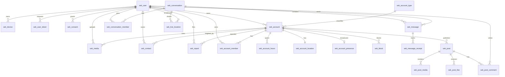

# Sekitar — ERD Fase 1–2

Dokumen ini merancang skema database untuk fondasi aplikasi **Sekitar**:
identitas pengguna, akun personal/usaha, perangkat, consent, profil, media,
kontak, blokir, laporan, dan lokasi. Fitur chat, post, dan order belum masuk
skema ini; tabelnya ditambahkan pada fase berikutnya.

Keputusan produk: lihat [`../AGENTS.md`](../AGENTS.md) bagian *Product vision*
dan *Phase 0 decisions*.

## Prinsip

- Domain mobile memakai prefix **`sek_`** dan tidak mencampur tabel admin CMS
  (`app_*`, `sys_*`, `fin_*`). Admin/operasional tetap memakai CMS.
- Primary key `bigint unsigned`, waktu disimpan **UTC**, charset `utf8mb4`.
- Satu `sek_user` memiliki banyak `sek_account`; satu akun selalu dimiliki satu
  user. Akun personal dibuat otomatis saat registrasi.
- Akun usaha dapat memiliki anggota (staff) sejak awal, walau MVP hanya memakai
  role `owner`.
- Lokasi bisnis (statis) dan lokasi live (presence) dipisah agar warung tetap
  tampil di peta saat offline, sementara driver hanya tampil saat online.
- Koordinat memakai `POINT SRID 4326` (WGS84) dan `SPATIAL INDEX`.
- Perubahan skema memakai file di `database/migrations/` dengan nama
  `<14 digit timestamp>_sekitar_<deskripsi>.sql`; jangan memakai migrasi CI3.

## Entitas

### Identitas

**`sek_user`** — kredensial login dan identitas dasar.

| Kolom | Tipe | Catatan |
| --- | --- | --- |
| `user_id` | bigint unsigned PK | |
| `email` | varchar(190) unique | disimpan lowercase |
| `password_hash` | varchar(255) | Argon2id/bcrypt |
| `email_verified_at` | datetime null | |
| `display_name` | varchar(80) | nama tampilan personal |
| `status` | enum('active','suspended','deleted') | |
| `last_login_at` | datetime null | |
| `created_at`, `updated_at` | datetime | UTC |

**`sek_user_token`** — token verifikasi email dan reset password (hash saja).

`token_id`, `user_id` FK, `purpose` enum('verify_email','reset_password'),
`token_hash` char(64) unique, `expires_at`, `used_at` null, `created_at`.

**`sek_device`** — sesi per perangkat sekaligus menyimpan token.

`device_id` PK, `user_id` FK, `device_uuid` varchar(64), `platform`
enum('ios','android'), `app_version`, `push_token` null,
`access_token_hash` char(64), `access_expires_at`,
`refresh_token_hash` char(64) unique, `refresh_expires_at`,
`active_account_id` FK null, `last_seen_at`, `revoked_at` null, `created_at`.
Unique (`user_id`, `device_uuid`).

**`sek_consent`** — riwayat persetujuan; baris baru setiap berubah.

`consent_id`, `user_id` FK, `scope` enum('location','notifications','marketing'),
`granted` tinyint(1), `policy_version` varchar(20), `device_id` FK null,
`granted_at`, `revoked_at` null, `created_at`.
Index (`user_id`, `scope`, `created_at`).

### Akun dan profil

**`sek_account_type`** — referensi tipe akun, bukan data tenant.

`type_code` varchar(32) PK (`personal`, `warung`, `restoran`, `tambal_ban`,
`driver_motor`, `driver_mobil`, `kurir_makanan`, `terapis`, `jasa_umum`),
`label_id`, `label_en`, `icon`, `allows_presence` tinyint, `allows_services`
tinyint, `sort_order`, `is_active`.

**`sek_account`**

| Kolom | Tipe | Catatan |
| --- | --- | --- |
| `account_id` | bigint unsigned PK | |
| `user_id` | bigint FK | owner |
| `type_code` | varchar(32) FK | tipe akun |
| `handle` | varchar(40) unique | huruf kecil, tanpa spasi |
| `display_name` | varchar(120) | |
| `bio` | varchar(500) null | |
| `avatar_media_id` | bigint FK null | |
| `cover_media_id` | bigint FK null | |
| `phone` | varchar(32) null | opsional, tidak publik |
| `address` | varchar(255) null | alamat teks |
| `service_radius_m` | int unsigned default 5000 | batas layanan |
| `is_online` | tinyint default 0 | untuk tipe presence |
| `verified_at` | datetime null | verifikasi admin |
| `status` | enum('active','suspended','archived') | |
| `created_at`, `updated_at` | datetime | |

Index (`user_id`), (`type_code`, `status`), (`display_name`).

**`sek_account_member`** — akses staff ke akun usaha.

`account_id`, `user_id`, `role` enum('owner','manager','staff'), `status`,
`created_at`; PK (`account_id`, `user_id`).

**`sek_account_hours`** — jam buka akun usaha.

`hours_id`, `account_id` FK, `weekday` tinyint (0 = Minggu), `open_time` time,
`close_time` time, `is_closed` tinyint. Index (`account_id`, `weekday`).

**`sek_account_location`** — lokasi dasar/statis (wajib untuk akun usaha).

`account_id` PK/FK, `location` POINT NOT NULL SRID 4326, `address`,
`source` enum('manual','gps','geocode'), `updated_at`.
`SPATIAL INDEX (location)`.

**`sek_account_presence`** — lokasi live untuk driver/layanan online.

`account_id` PK/FK, `location` POINT NOT NULL SRID 4326, `accuracy_m` smallint,
`heading` smallint, `speed_mps` decimal(5,2), `is_online` tinyint,
`updated_at`. `SPATIAL INDEX (location)`.
Baris hanya dibuat/diperbarui saat consent `location` aktif.

### Media dan interaksi sosial dasar

**`sek_media`**

`media_id`, `owner_user_id` FK, `purpose`
enum('avatar','cover','post','chat','document'), `path`, `mime`, `size_bytes`,
`width`, `height`, `checksum_sha256`, `status`
enum('pending','ready','rejected'), `created_at`.

**`sek_contact`** — kontak tersimpan (dasar feed Post fase 5).

`contact_id`, `owner_user_id` FK, `account_id` FK, `alias` varchar(80) null,
`created_at`. Unique (`owner_user_id`, `account_id`).

**`sek_block`**

`blocker_account_id`, `blocked_account_id`, `reason` null, `created_at`;
PK (`blocker_account_id`, `blocked_account_id`).

**`sek_report`** — laporan akun/konten, ditinjau admin.

`report_id`, `reporter_user_id` FK, `target_account_id` FK,
`category` enum('spam','abuse','fraud','inappropriate','other'),
`description` varchar(1000) null, `status`
enum('open','reviewing','resolved','rejected'), `created_at`, `reviewed_at` null,
`reviewed_by` bigint null.

### Chat

**`sek_conversation`** — direct atau group.

`conversation_id`, `type` enum('direct','group'), `direct_key` varchar(64)
unique (format `minUserId:maxUserId`, hanya direct), `title`, `avatar_media_id`,
`created_by_user_id`, `last_message_at`, `created_at`, `updated_at`.

**`sek_conversation_member`**

`conversation_id`, `user_id`, `role` enum('owner','member'),
`last_read_message_id`, `joined_at`, `left_at` null, `muted_at` null;
PK (`conversation_id`, `user_id`).

**`sek_message`**

`message_id`, `conversation_id`, `sender_user_id`, `sender_account_id` null,
`type` enum('text','image','file','audio','location','system'), `body` text,
`media_id` null, `latitude` decimal(10,7), `longitude`, `location_label`,
`reply_to_message_id` null (self FK), `created_at`, `edited_at`, `deleted_at`.
Index (`conversation_id`, `message_id`).

**`sek_message_receipt`**

`message_id`, `user_id`, `delivered_at`, `read_at`; PK
(`message_id`, `user_id`). Baris dibuat saat pesan diambil/read oleh anggota
lain.

**`sek_live_location`** — berbagi lokasi sementara di percakapan.

`conversation_id`, `user_id`, `location` POINT NOT NULL SRID 4326,
`accuracy_m`, `expires_at`, `updated_at`; PK (`conversation_id`, `user_id`),
`SPATIAL INDEX`. Baris kedaluwarsa tidak dikembalikan API.

### Post dan feed

**`sek_post`**

`post_id`, `user_id`, `account_id`, `caption` varchar(2200), `status`
enum('active','hidden','deleted'), `created_at`, `updated_at`.
Index (`account_id`, `status`, `post_id`).

**`sek_post_media`** — carousel media, urut `sort_order`.

`post_id`, `media_id`, `sort_order`; PK (`post_id`, `media_id`).

**`sek_post_like`**

`post_id`, `user_id`, `created_at`; PK (`post_id`, `user_id`).

**`sek_post_comment`**

`comment_id`, `post_id`, `user_id`, `body` varchar(1000), `created_at`,
`deleted_at` null.

`sek_report.post_id` (nullable FK) ditambahkan untuk laporan post.

## ERD

## Integrasi dengan CMS

- Admin CMS mengelola verifikasi akun (`sek_account.verified_at`), laporan, dan
  moderasi. Tabel `app_user`/`sys_tenant` tidak dipakai untuk login mobile.
- Fase 6 dapat menambahkan `sek_account.tenant_id` (nullable) untuk menautkan
  akun usaha ke tenant Finance tanpa mengubah struktur awal.
- Jangan menyalin data `app_user` ke `sek_user`; keduanya domain berbeda.
- Auto-increment dan FK mengikuti konvensi tabel CMS yang ada.

## Rencana migrasi

1. `20261126000200_sekitar_identity.sql` — `sek_user`, `sek_user_token`,
   `sek_device`, `sek_consent`, `sek_rate_limit`.
2. `20261126000300_sekitar_accounts.sql` — `sek_account_type`, `sek_media`,
   `sek_account`, `sek_account_member`, `sek_account_hours`,
   `sek_account_location`, `sek_account_presence`, seed tipe akun.
3. `20261126000400_sekitar_social.sql` — `sek_contact`, `sek_block`,
   `sek_report`.
4. `20261126000500_sekitar_chat.sql` — `sek_conversation`,
   `sek_conversation_member`, `sek_message`, `sek_message_receipt`,
   `sek_live_location`.
5. `20261126000600_sekitar_posts.sql` — `sek_post`, `sek_post_media`,
   `sek_post_like`, `sek_post_comment`, plus `sek_report.post_id`.

Setiap migrasi harus aman dijalankan pada database CMS yang sudah berisi data
(damai, tanpa menyentuh tabel lama) dan dicatat di `sys_update_migration`.

## Hal yang belum diputuskan

- Penyedia email transaksional untuk verifikasi/reset (wajib sebelum Fase 1
  dirilis).
- Kebijakan retensi `sek_account_presence` (mis. hapus baris offline > 30 hari)
  dan histori lokasi untuk ride-hailing di Fase 6.
- Apakah akun usaha boleh memiliki lebih dari satu owner (default: satu owner,
  staff ditambahkan lewat `sek_account_member`).
